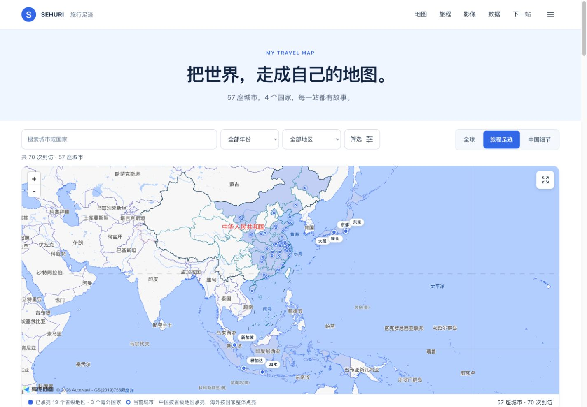
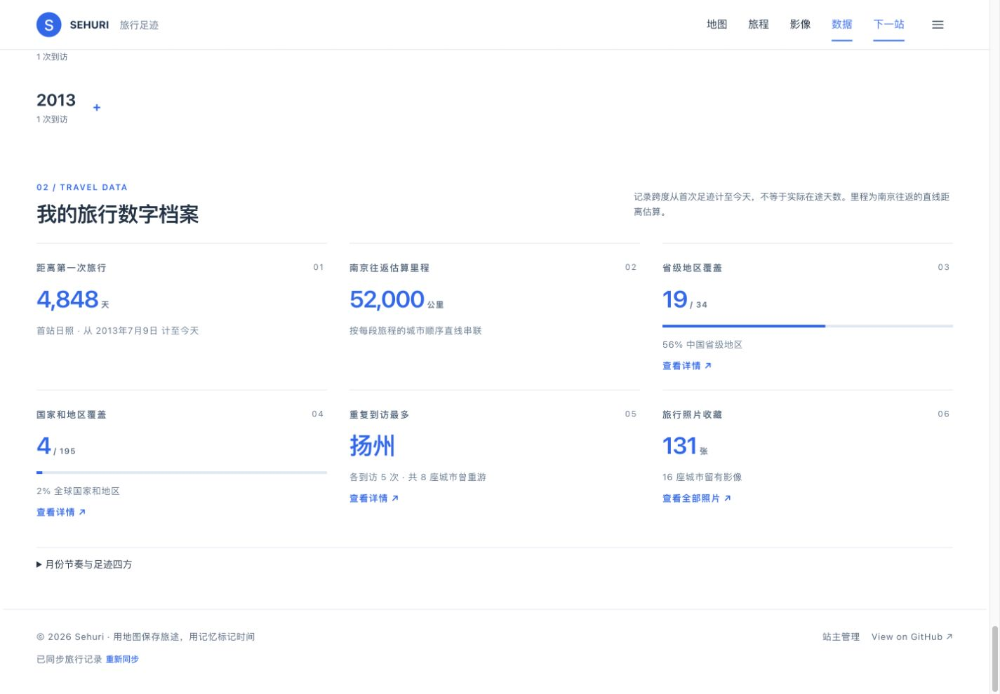

<p align="center">
  
</p>

<h1 align="center">Sehuri 的旅行足迹</h1>

<p align="center">
  用地图连接走过的城市，用时间保存真实发生过的旅行。
</p>

<p align="center">
  <a href="https://sehuri.github.io/travel-map/"><strong>在线打开旅行地图 ↗</strong></a>
  ·
  <a href="https://sehuri.github.io/travel-map/discover.html">下一站去哪</a>
  ·
  <a href="./SUPABASE_SETUP.md">后台配置</a>
</p>

<p align="center">
  
  
  
  
</p>

<p align="center">
  <a href="https://sehuri.github.io/travel-map/">
    
  </a>
</p>

从 2013 年黄海边的第一次远行，到 2026 年国庆的新加坡与印尼之旅。这里不只记录打卡数字，也保存城市、路线、照片、攻略，以及仍在期待的下一站。

> **更新于 2026-10-16**：首页与随机旅行页已统一为清爽白蓝风格；“旅程足迹”中国按省级点亮，海外按整个国家点亮。

### 当前记录

以下为 2026-10-16 从已同步网站读取的数据快照，不是写死在页面里的统计值：

| 城市与到访 | 旅行范围 | 旅行年份 | 正式旅程 | 照片 |
| --- | --- | --- | --- | --- |
| 57 座城市 · 70 次到访 | 4 个国家 · 19 个中国省级地区 | 8 个年份 | 9 段已发布旅程 | 131 张 |

网站优先读取 Supabase 后台内容，连接不可用时使用仓库备用资料；后台补录的历史年份、重复到访、旅程和照片可能多于代码内置数据。当前数字和愿望数量以网站实际同步结果为准。

## ✨ 项目亮点

| 旅行足迹 | 正式旅程 | 记忆重现 | 下一站 |
| --- | --- | --- | --- |
| 中国省级＋海外国家点亮，筛选与时间线联动 | 多城市、交通、预算、照片和游记组成完整档案 | 往年今日、重复到访与月份热力图 | 条件筛选 → 比较候选 → 资源地图与分日攻略 |

## 🖼️ 界面预览

<table>
  <tr>
    <td width="50%">
      <a href="./docs/readme/02-wishlist.jpg"></a><br>
      <strong>仍在期待的远方</strong><br>
      <sub>后台维护想去程度，前台自动分组并同步地图光点。</sub>
    </td>
    <td width="50%">
      <a href="./docs/readme/03-travel-data.jpg"></a><br>
      <strong>旅行数字档案</strong><br>
      <sub>累计时间、估算里程、地区覆盖、照片数量与月份热力图。</sub>
    </td>
  </tr>
</table>

<p align="center">
  <a href="./docs/readme/04-journey.jpg"></a><br>
  <sub>正式旅程详情页：把路线、交通、照片、攻略和旅行感想重新放回同一段时间里。</sub>
</p>

<p align="center">
  <a href="./docs/readme/05-discover.jpg"></a><br>
  <sub>下一站去哪：比较交通与预算，再查看真实资源地图和每日攻略草案。</sub>
</p>

> 截图来自真实页面；点击可查看原尺寸。首页和随机旅行页采用白蓝风格，旅程等独立页面目前保留原有布局。可通过 `npm run capture:readme` 重新采集首页、愿望、统计与最新旅程；需要地图网络连接，脚本不伪造地图或统计。

## 🧩 网站功能

### 清爽白蓝地图首页

- 按本轮 `docs/design/2026-10-15/light-components-v2/02-blue-map.png` 改版：浅蓝精简引导 → 地图与共享筛选 → 开放数字条 → 最近旅程 → 最近到访与城市评分 → 放映、回忆、完整时间线与详细统计。
- 白色/浅灰蓝背景、蓝色强调、中文无衬线字体；照片只用于真实旅行内容，不再铺满首页。统计、时间线与排行使用留白和细分隔线。
- 桌面采用五主题导航与更多菜单；手机保留四项底栏，筛选折叠展开。点击地图城市先显示白色预览卡，手机在地图下显示面板，支持重复到访日期切换，再进入现有完整记忆。
- 首页数字由当前记录计算；旅程使用真实封面、标题、日期与照片数量。完整档案、旧年份、完整相册、排行、攻略与管理入口继续可达。
- 无可用音源时不创建音乐浮层；有音源时以导航区小按钮播放/关闭。其他独立页面维持原有界面，随机旅行页另按下述白蓝规范改造；不改数据库或后台权限。
- 本地预览：`npm run dev`，打开 `http://127.0.0.1:4173/`。详细验收及截图见 [design-qa.md](./design-qa.md) 与 `docs/qa/2026-10-15/`。
- 最新旅程足迹验收与国家填色截图见 [2026-10-16 验收记录](./docs/qa/2026-10-16/journey-footprints/README.md)。
- 导航图标使用 [Heroicons v2.2.0](https://github.com/tailwindlabs/heroicons/tree/v2.2.0)，本地资源及 MIT 许可证位于 `assets/vendor/heroicons/`。

### 旅行照片素材

- 大阪环球影城、布罗莫日出、星耀樟宜与鱼尾狮公园四张真实照片及历史背景选择工具仍保留，不删除用户素材。
- 白蓝首页与随机旅行页均不再初始化壁纸或下载背景照片。旅行照片集中用于真实内容；已有网页素材保留原图内容和水印，并移除 EXIF 元数据。

### 城市景点评等级

- 从城市详情进入景点评级，也可在独立页面切换城市、搜索景点、筛选已评／未评。
- 当前目录覆盖 53 座城市、721 个景区、博物馆、公园及街区等游览点，包括城市辖区周边目的地。
- 五档选择：夯 / 顶级 / 人上人 / NPC / 拉完了；展示全站各档人数与占比。
- 无需手动登录，每个浏览器对每个景点仅可提交一次，提交后不可修改。清除浏览器数据或换设备后会成为新访客，不等同于实名“一人一票”。
- 需先执行 [景点投票初始化 SQL](./supabase/attraction_ratings.sql)，见 [配置说明](./SUPABASE_SETUP.md#景点评等级)。未启用或连接失败时仅展示目录，不伪造投票结果。

### 下一站去哪（全国城市推荐）

- 按 `docs/design/2026-10-15/discover-blue-v1/` 三张连续状态图实施：填写条件 → 比较候选 → 目的地资源与每日攻略。白色导航、浅蓝摘要、开放表单和行式候选指标，与白蓝首页一致；样式只作用于随机旅行页。
- 修改条件保留输入，修改后明确标为旧结果；返回候选恢复原批次和选择焦点，不重新抽取或请求资源。只有重新提交/换一组才产生新批次。
- 桌面表单与实时摘要分栏、三个候选平级比较；中屏和手机按列重排，更多条件可折叠，地图与分日攻略联动。资源模式与日期模式不同时激活。
- 保留 1–14 天与最多三项偏好校验、真实行政 ID、筛选/去重、连接重试/示例降级、地图失败重试与可用文字列表、愿望保存/去重、点击复制及手动复制降级。交通各方式单独标注实际来源或估算，攻略始终标为未核验草案。
- 可选择完整行政归属的出发地、1–14 天、距离、月份、预算、省份、节奏、是否排除已去过城市，以及最多 3 项旅行偏好。
- 全国模式按行政编码收录地级市、直辖市和县级市，不局限现有旅行记录；实际范围以高德目录为准，台湾城市暂待补充。
- 结果包含城市概览、旅游资源列表和地图；全国服务已启用，连接异常时会明确提示，并提供可选的 18 城示例体验。
- 景点与美食分组展示；地图可拖动、缩放，编号对应资源介绍。生成攻略后，选择某一天只展示当天点位与顺序连线，选择全部可查看各天；保留复制旅行灵感和每日攻略入口。
- 随机旅行保存的愿望存于当前浏览器设备，并去重合并到首页；这不是后台云同步。攻略是按现有点位与距离算法生成的草案，交通、价格、开放时间和预约均需出发前核验。
- 服务端 Key 不进入公开仓库，查询有每日预算保护。启用步骤见 [DISCOVER_SETUP.md](./DISCOVER_SETUP.md)。

### 全球、旅程足迹与中国细节

- 默认“中国细节”视图使用高德地图，显示国内行政区填色和周边国家概貌；可切换“全球”视图，通过 Leaflet 与 CARTO 世界底图查看更远的目的地。
- 全球底图直接使用原始 WGS-84 坐标；仅中国大陆坐标在高德图层转换为 GCJ-02。高德安全密钥由 Supabase 代理保护，启用步骤见 [AMAP_MAP_SETUP.md](./AMAP_MAP_SETUP.md)。
- “中国细节”按国内市级行政区填色，海外城市以带名称的光点呈现。
- “旅程足迹”视图：中国继续按省级地区点亮，海外去过任一城市即点亮所属整个国家；年份、地区、评分和搜索筛选同步改变填色范围。现有日本、新加坡、印度尼西亚均按整国显示；图例分别统计中国省级地区和海外国家，不把两种层级混算。
- 使用高德真实行政区边界：[中国省级与世界国家图层](https://lbs.amap.com/api/javascript-api-v2/guide/layers/districtlayer)。海外按国家名称自动匹配，无需为每国补充省级映射；旧日本四都道府县边界素材保留但不再加载（来源 [JapanPrefGeoJson](https://github.com/amay077/JapanPrefGeoJson)，Public Domain）。城市标记与详情入口不变。
- 点击已到访市域或城市光点即可打开对应旅行记忆；国家面可查看该国到访城市清单。
- 切换到“仍在期待”时，地图同步改为愿望目的地视图，点击光点可查看旅行攻略；此时不再填亮已到访国家。
- 高德资源不可用时仍可使用全球地图，下方时间线也可继续浏览。

### 旅行数据统计

网站会根据旅行记录自动展示：

- 已到访城市数量
- 已覆盖国家数量
- 持续旅行的年份数量
- 根据城市经纬度自动计算最北、最南、最东和最西足迹，并可点击查看城市详情

最新到访包括 2026 年国庆的新加坡、雅加达、泗水与广州，保留雅加达两次到访；正式旅程记录 10 月 1 日至 7 日南京出发与返回、六段航班和布罗莫火山接驳。日期与航班来自用户提供的行程书，预算仅记为计划值，不推断实际花费。完整统计见上方带日期的数据快照。

### 年度旅行时间线

- 按年份整理所有到访城市
- 支持按城市名称搜索，并按年份、国家或地区、社区评分组合筛选
- 筛选结果同步更新地图填色、标记、视野、当前结果数量、最近到访、时间线和四方足迹，并支持一键清除；旅行总览仍展示完整档案统计。
- 按年份折叠整理城市到访，保留日期、国家、经纬度和重复到访记录；最近到访使用真实缩略图，没有照片时展示明确空态。
- 城市卡片展示平均分与评分人数，并提供实时更新的城市评分排行榜
- 点击城市卡片可查看详细旅行介绍
- 每座城市拥有 `?city=城市名` 独立链接，并支持复制或系统分享

### 正式旅程档案

- 可把多个已到访城市组合成一趟完整旅程，并维护起止日期、城市顺序和城市间交通
- 支持实际或估算里程、预算、住宿、同行人、旅程封面与总结
- 分别记录行前计划、旅途中记录和旅行后感想
- 可从现有城市照片中选择旅程照片，并关联 HTML/PDF 攻略或游记
- 每趟旅程拥有独立详情页；城市详情会反向展示到访次数、全部日期及涉及的旅程
- 同日换城可在两站停留日期中重叠；若旧档案的离开日越过下一站，前台会按行程顺序推算显示，后台保存时则提示站主改正原始日期
- 内置包括“2025 厦门实习”在内的旅程档案；厦门实习按真实换城日期记录福州、港深和漳州往返，重复停留的城市会保留每一站

### 地图路线回放

- 使用高德地图标准底图呈现真实城市位置、道路、行政区与地理环境，并自动缩放到整段旅程
- 在旅程详情页选择任意已发布旅程，按时间依次点亮城市与行进线路
- 自动识别飞机、铁路、驾车、巴士、水路、步行等交通方式，并使用不同线路颜色
- 到站时同步展示代表照片、到离日期、停留天数、交通方式和分段里程
- 未填写分段里程时按城市坐标自动估算，并明确标注为估算值
- 支持播放、暂停、上一站、下一站以及点击地图或站点目录跳转
- 可生成包含旅程与当前站点的独立分享链接，打开后直接定位到路线回放

### 往年今日与记忆重现

- 首页根据当天日期自动查找“往年今天”的旅行足迹：先匹配城市到达日，没有结果时再查旅程档案中各城市的停留区间；换城当天优先显示新到达的城市
- 显示距离最近一趟正式旅程结束已经过去多少天
- 汇总同月份在不同年份留下的城市到访记录
- 支持随机翻看一座城市，并直接打开对应城市记忆
- 同一城市多次到访时，自动并列展示第一次与最近一次到访

### 城市资料与公众评分

- 站主可通过邮箱登录，直接在城市详情中填写最喜欢的地点、吃过的食物和适合旅行天数
- 访客可对每座城市提交 1—10 分评分，并随时修改自己的评分
- 页面自动计算并显示平均分和评分人数
- 数据由 Supabase 保存，并通过行级安全策略限制编辑权限

首次启用资料与评分功能前，请按 [Supabase 配置说明](./SUPABASE_SETUP.md) 完成数据库与前端连接。

### 站主管理后台

- 站主通过邮箱登录 [`admin.html`](./admin.html)
- 可添加城市，修改日期、国家、地区、坐标和描述
- 可上传和排序照片，并指定城市封面图
- 可新增、编辑、排序或隐藏愿望清单项目，并设置计划去的时间与三级想去程度
- 可基于已到访城市新建、编辑、发布或隐藏正式旅程档案
- 可查看并删除明显异常的公众评分，平均分会自动重算
- 采用“Supabase 后台内容优先、代码资料兜底”的方式，仍可继续直接修改代码维护

启用后台前需要额外运行 [`supabase/admin_backend.sql`](./supabase/admin_backend.sql)，具体步骤见 [Supabase 配置说明](./SUPABASE_SETUP.md)。

### 城市照片画廊

- 全部照片以错落相纸照片墙展示，可按城市筛选，保留照片说明与城市到访日期。
- 首页“旅程放映室”支持全部照片、按旅程和按城市放映。照片保持原始显示尺寸，底部胶片带可跳转到任意照片，城市切换时显示短暂章节标题卡，并以柔和叠化过渡。
- 放映离开可视范围或浏览器切到后台时暂停计时，返回后继续；尊重系统减少动态效果的设置。
- 首页放映支持随机播放，一轮内不重复，亦可按旅程或城市切换范围。
- 背景音乐播放器与两首《かたわれ時》曲目配置已预留；目前未配置可用音源，因此不显示播放控件、不请求音频。获得可用于网站播放的 MP3/M4A 文件后，在 `assets/site-bgm-config.js` 填写音频地址即可依次循环；首次发声需访客点击。音乐平台分享链接不能直接当作音频地址。
- 在城市详情中浏览真实旅行照片
- 支持缩略图展示和大图预览
- 照片按城市分类保存
- 当前收录东京、京都、北京、大阪、苏州、镰仓、阿拉善盟和黄山等城市的旅行影像

### 下一站愿望清单

- 通过桌面导航“下一站”、菜单“我的愿望”或手机底栏“愿望”切换到愿望清单。
- 收藏未来想去的目的地
- 按“最想去 / 很想去 / 有机会去”自动分组和排序，地图光点也同步显示优先程度
- 下方地图会同步切换为愿望目的地视图，不再继续显示已到访城市
- 提供“在地图上查看”快捷入口，手机端无需越过全部愿望卡片
- 展示目的地特色、计划时间与简要旅行建议
- 后台可填写国家/地区、经纬度、坐标来源和地图标签；瑞士预设代表点为 2027 年计划中的格林德瓦／少女峰地区
- 未设置地图位置的新增目的地仍保留卡片，并明确提示补充定位，不再静默漏掉
- 可跳转至常用旅行平台继续查看攻略

代码备用清单包含 27 个目的地，实际展示还会合并后台新增条目（例如瑞士）与当前设备保存的随机旅行愿望，并应用后台隐藏状态，因此不固定为 27 个。广州、新加坡和印尼已从愿望中移除，已到访记录与旅程仍保留。
地图定位字段通过 [wishlist_map_location.sql](./supabase/wishlist_map_location.sql) 启用，不会修改已有旅行记录或手动填写的愿望文案。

### 响应式体验

- 适配电脑、平板和手机
- 首页手机端提供“地图、旅程、影像、愿望”底部快捷导航，旅行年份可折叠；随机旅行页按相同风格重排表单、候选和地图攻略。
- 支持键盘操作与语义化对话框
- 支持系统“减少动态效果”偏好
- 地图保留真实引擎、坐标处理、缩放与全屏；白蓝页面使用清晰焦点、加载、错误与空状态。

## 🧭 旅行版图

足迹从中国东部沿海出发，逐渐延伸至东北、西北、华南、日本关西与关东，再到新加坡和印度尼西亚。

部分旅行节点：

| 年份 | 旅行足迹 |
| --- | --- |
| 2013 | 日照 |
| 2023 | 淮安、青岛、南京 |
| 2024 | 杭州、武汉、上海、北京、黄山等 |
| 2025 | 哈尔滨、三亚、香港、西安、阿拉善盟等 |
| 2026 | 大阪、京都、东京、镰仓、长沙、衡阳、绍兴、新加坡、雅加达、泗水、广州等 |

## 🎨 设计理念

首页与随机旅行页以“清爽白蓝地图”为当前视觉方向：

- 白色为主背景，极浅灰蓝划分辅助区域，蓝色强调操作和地图足迹。
- 现代中文无衬线字体，统一标题、正文、数字和辅助文字层级。
- 用留白、对齐、细分隔线组织统计、时间线和排行，不再给每个模块套厚重卡片。
- 地图、真实照片与必要浮层保留适度圆角和轻微阴影；照片用于旅程封面、城市缩略图和相册，不铺满页面。
- 不使用荧光黄、全屏照片壁纸或大面积绿色磨砂背景；旧旅行素材保留但不初始化为首页壁纸。
- 时间线负责回望过去，愿望清单指向下一次出发

> 世界很大，我用足迹丈量。

## 🛠️ 技术实现

- 原生 HTML、CSS 与 JavaScript
- 高德地图 JS API 2.0 与省级／国家行政区图层；Leaflet + CARTO 全球底图
- GitHub Pages 静态部署
- Supabase 内容、评分、认证、照片存储与服务端地图代理；本地旅行资料提供兜底
- 原生 Heroicons SVG，不迁移 React、不引入多套组件库
- Node.js 单元测试、Playwright 浏览器测试与 GitHub Actions 持续集成

## 📁 项目结构

```text
├── index.html
├── journey.html
├── discover.html
├── attractions.html
├── admin.html
├── travel-map.html
├── assets/
│   ├── app.js
│   ├── styles.css
│   ├── map-engine.js
│   ├── admin-region-engine.js
│   ├── stats-engine.js
│   ├── discover.js / discover.css
│   ├── discover-engine.js / discover-itinerary.js
│   ├── attraction-data.js
│   ├── admin.js
│   ├── admin.css
│   ├── content.js
│   ├── data.js
│   ├── journey-engine.js
│   ├── journey.js
│   ├── journey.css
│   ├── route-replay-engine.js
│   ├── wishlist-engine.js
│   ├── memory-engine.js
│   └── photos.js
├── docs/
│   ├── design/          # 选定视觉方案与交接
│   ├── qa/              # 真实浏览器截图与验收
│   └── readme/          # 本文预览图
├── tests/               # 单元与浏览器回归
├── supabase/
│   ├── schema.sql
│   ├── admin_backend.sql
│   ├── journeys.sql
│   ├── attraction_ratings.sql
│   ├── wishlist_map_location.sql
│   └── functions/
└── photos/
    ├── 东京/
    ├── 京都/
    ├── 北京/
    └── ...
```

## 🚀 维护与发布

提交前可重复执行完整测试：

```bash
npm ci
npx playwright install chromium
npm test
```

其中 `npm test` 会运行数据、地图、旅程、评分等单元测试，以及首页、旅程、随机旅行、景点评级、愿望清单、背景兼容的 6 组浏览器回归。旅程足迹本轮已通过 73 项单元测试和这 6 组浏览器检查；真实地图另在浏览器验证桌面与手机布局。推送 `main` 或创建 Pull Request 时，GitHub Actions 会执行同一套检查。

首次本地运行：

```bash
npm ci
npm run dev
```

打开 `http://127.0.0.1:4173/`。地图与随机旅行在线接口需要相应配置和网络；不在公开前端写入服务端密钥。相关说明：[高德地图](./AMAP_MAP_SETUP.md)、[随机旅行](./DISCOVER_SETUP.md)、[内容与评分](./SUPABASE_SETUP.md)。

界面调整后可重新生成 README 截图：

```bash
npm run capture:readme
```

日常发布流程：

```bash
git status
git diff
git add <本次修改的文件>
git commit -m "说明本次修改"
git push origin main
```

推送到 `main` 后，GitHub Pages 会自动更新；提交前应确认没有夹带与本次功能无关的文件。

## 📍 关于这个项目

旅行结束以后，车票会遗失，相册会越积越多，而地图能让不同年份的记忆重新产生联系。

这个网站会随着新的旅程持续更新。每增加一座城市，地图上就会多一个光点，时间线上也会多一段属于那一天的记录。
